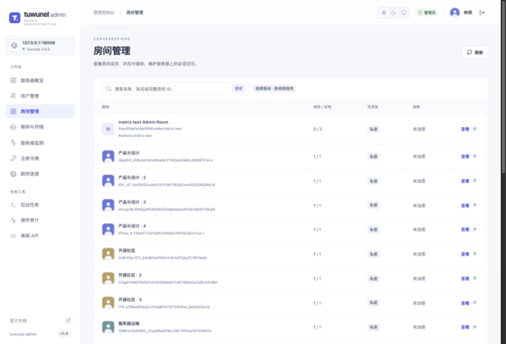
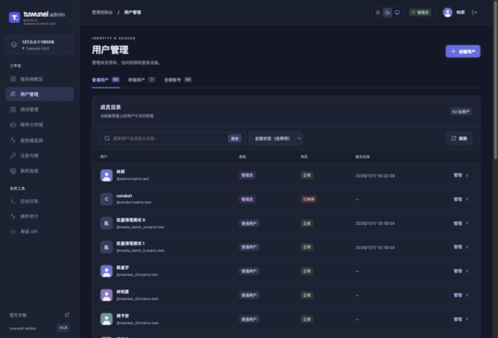
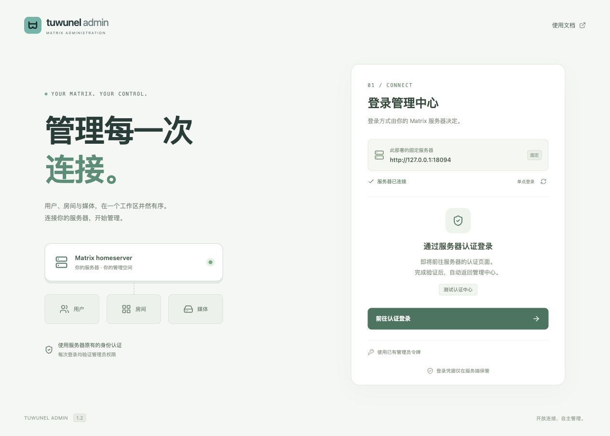
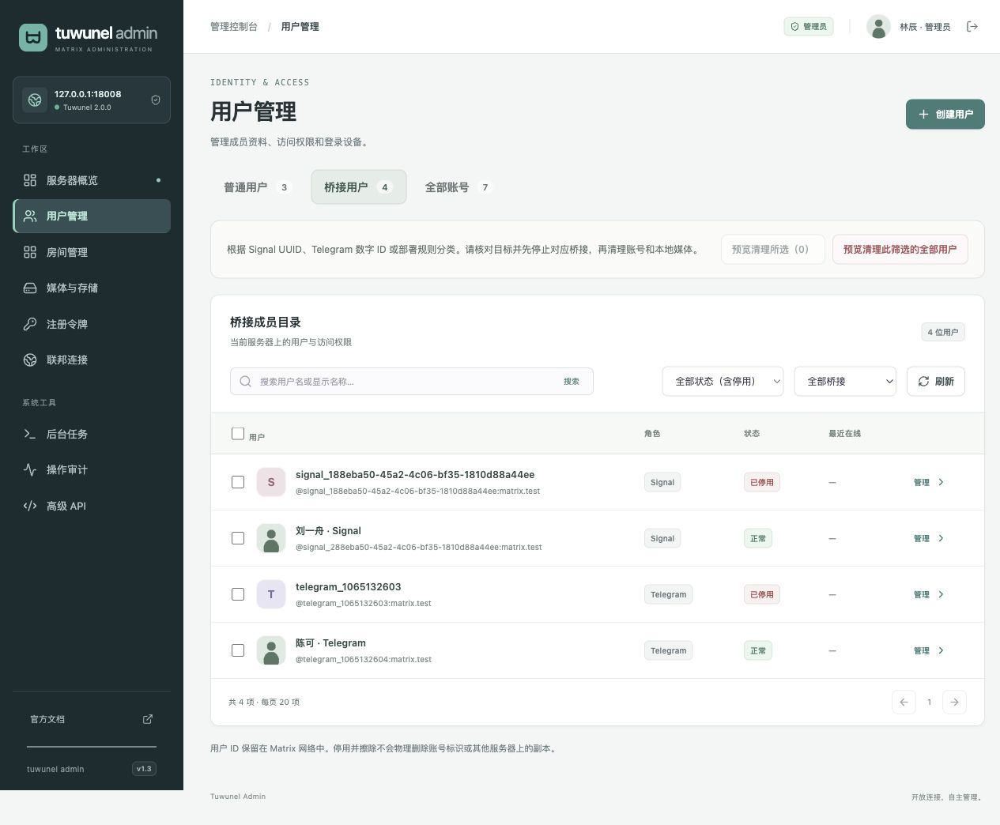
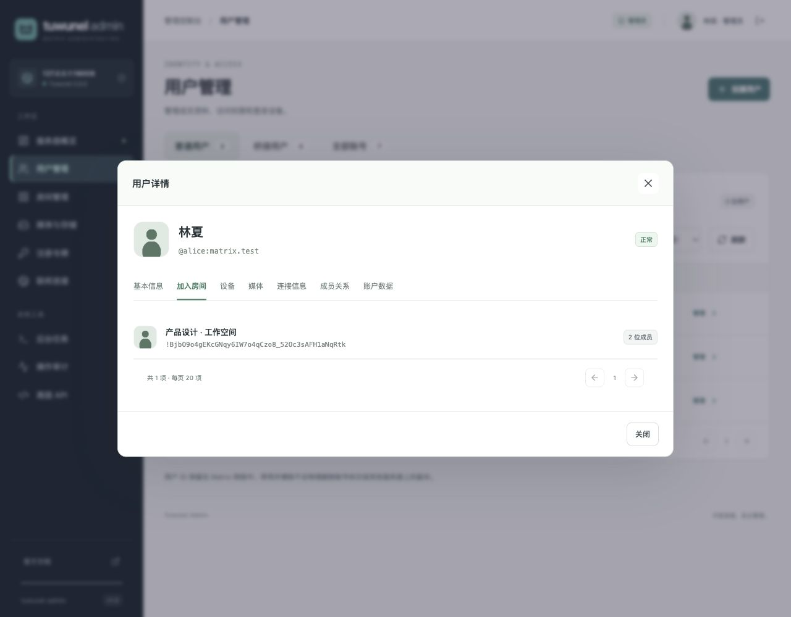

# Tuwunel Admin

中文 Tuwunel / Matrix 管理中心。**Rust + Tokio + Axum 后端，React / TypeScript 前端**。生产镜像不再需要 Node.js，所有运行设置通过 `config.toml` 管理，不读取 `.env`。

当前版本 **1.4.0**；双架构镜像 `utoptop/tuwunel-admin:1.4`，同时更新原约定的 `:1.0` 标签。支持 `linux/amd64` / `linux/arm64`。MIT License。

## 本次改进

- 用户媒体支持全量批量清理，逐人显示进度，可停止与重试。
- 用户、房间和媒体用量支持自动下拉加载，房间列表显示名称与头像。
- Rust 只读采集器展示 Tuwunel 进程指标、文件配置与注册 IP 审计。
- 全新管理台布局，支持浅色、深色及跟随系统，保留管理员头像与服务器版本。
- 延续部署配置锁定服务器、自动密码 / SSO / OAuth 登录、桥接用户分组与清理、媒体生命周期和 73 个管理 API 操作。




## 部署

```bash
git clone https://github.com/utoptop/tuwunel-admin.git
cd tuwunel-admin
cp config.example.toml config.toml
# 按下方示例编辑 config.toml
docker compose up -d
```

Compose 只读挂载 `config.toml`，持久化 `/app/data`，默认绑定宿主机 `127.0.0.1:8080`。更改端口映射请编辑 `compose.yaml`，不使用 `.env`。服务器启动时读取配置，更改后运行 `docker compose restart`。

### 固定并锁定 Matrix 服务器

```toml
[server]
listen = "0.0.0.0:8080"
public_url = "http://localhost:8080"
cookie_secure = false
static_dir = "./dist"

[matrix]
homeserver = "https://matrix.example.com"
locked = true
allowed_homeservers = []

[storage]
data_dir = "./data"
```

登录页只展示固定服务器信息，不提供地址输入框。是否允许更换服务器只能由部署者修改此配置并重启决定；后端会拒绝其他地址，不能通过直接调用 API 绕过。

密码登录的上游是 Docker 内网服务时，可以直接配置 `homeserver = "http://tuwunel:8008"`，并将两个容器加入同一网络。Matrix 地址应是实际客户端 API 的 origin，不一定等于 Matrix ID 中的域名。

### 允许自定义输入服务器

```toml
[matrix]
locked = false
homeserver = "https://matrix.example.com" # 可留空；非空时作为默认地址
allowed_homeservers = []
```

使用面板的人可输入自己的 Matrix 服务器完整地址。修改地址后会清空旧密码及登录方式，自动重新检测；不能修改部署配置中的固定/开放规则。

未在配置中指定的自定义地址仅允许公网 HTTPS：连接时 DNS 解析结果必须全部是公网 IP；拒绝回环、私网、链路本地、保留地址及 IP 映射绕过，不跟随重定向，不继承系统代理。这样自定义输入不会成为任意内网代理。

如需限定可选服务器或使用内网 HTTP，明确列入配置：

```toml
[matrix]
locked = false
homeserver = "https://matrix.example.com"
allowed_homeservers = [
  "https://matrix.example.com",
  "https://chat.example.org",
  "http://tuwunel:8008"
]
```

非空列表将限制登录目标为这些地址以及默认 `homeserver`。显式配置的目标受到部署者信任，可以使用内网地址和 HTTP；不要将不受信任的域名加入此列表。每个地址独立绑定会话和策略，登录后不能通过管理请求更换上游。

### HTTPS 反向代理

```toml
[server]
listen = "0.0.0.0:8080"
public_url = "https://admin.example.com"
cookie_secure = true
static_dir = "./dist"
```

Caddy 在同一宿主机运行时：

```caddyfile
admin.example.com {
    reverse_proxy 127.0.0.1:8080
}
```

`public_url` 必须与浏览器实际访问的协议、域名、端口一致；HTTPS 必须配合 `cookie_secure = true`。Matrix 请求从 Rust 后端发出，无需给浏览器配置上游 CORS。后端始终验证 TLS 证书。

## 自动识别认证方式

系统读取 `/_matrix/client/v3/login` 和 `/_matrix/client/v1/auth_metadata`，兼容旧版 unstable metadata / issuer 发现接口。登录能力短暂缓存 60 秒；连接时自动检测，切换地址会丢弃旧结果。

| 服务器提供的方式 | 登录页与行为 |
| --- | --- |
| `m.login.password` | 显示 Matrix ID / 用户名和密码输入框 |
| `m.login.sso` + `m.login.token` | 点击「前往认证登录」，跳转到服务器的 SSO 入口；返回的一次性登录令牌由后端交换 |
| OAuth 授权服务器 | 自动注册公共客户端，使用授权码 + PKCE S256；后端交换、续期、撤销令牌 |
| 同时支持认证与密码 | 优先认证跳转，也可使用服务器确实提供的密码方式 |
| 仅能使用已有令牌 | 展开「使用已有管理员令牌」；不会伪造上游未提供的密码登录 |

认证回调固定为：

```text
https://admin.example.com/api/auth/callback
```

使用 OAuth 网页登录时，应通过 **HTTPS** 访问面板，并配置正确的 `server.public_url`、`cookie_secure = true`。自动注册使用本面板的公开 URL 作为 `client_uri`，认证服务器必须允许此域名和回调地址。若服务器关闭动态注册，请预注册 `token_endpoint_auth_method = none` 的公共 PKCE 客户端：

```toml
[[auth.clients]]
issuer = "https://auth.example.com/" # 必须与服务器公布的 issuer 完全一致
client_id = "your-public-client-id"
```

多个服务器可以配置多项。自动注册取得的公共客户端 ID 存入数据卷，重启后复用；兑换后的 Access Token 和 Refresh Token 只保存在后端内存中，不存入浏览器本地存储或审计；回调授权码仅用于一次交换。

认证地址取自 Matrix 服务器的公开元数据，不手写或猜测 `/auth` 页面。Tuwunel 接入 MAS 作为上游时，客户端仍应连接 Tuwunel 的地址和其公布的 issuer，由服务器继续跳转到 MAS；不要直接拿 MAS Token 当作 Tuwunel Token。参见 [Tuwunel MAS 集成说明](https://matrix-construct.github.io/tuwunel/authentication/providers/mas.html)、[OIDC 服务说明](https://matrix-construct.github.io/tuwunel/authentication/oidc-server.html) 和 [Matrix OAuth 规范](https://spec.matrix.org/latest/client-server-api/#oauth-20-api)。

浏览器必须能访问跳转到的服务器/认证域名。因此需要 SSO 时，`matrix.homeserver` 应使用浏览器可访问的地址，不能只填写 Docker 内部的服务名。独立内网认证服务必须在配置中显式允许：

```toml
[auth]
allowed_origins = ["http://auth.internal:8080"]
```

这只信任认证端点，不开放其他 Matrix 登录目标。公共认证端点仍执行 HTTPS、DNS/IP 校验和禁止自动重定向的后端请求策略。

每次认证都绑定当前浏览器、所选服务器、一次性 state 和 10 分钟期限；OAuth 同时使用 PKCE、issuer 检查、续期互斥。授权完成后通过 Matrix `whoami` 和管理员 API 校验身份，普通用户无法进入面板。退出会撤销本次创建的上游会话；从其他客户端导入的令牌不会被退出操作撤销。面板重启后需重新登录。



## 用户头像

用户列表和详情读取 Tuwunel 管理 API 的真实 `avatar_url`。后端优先使用 `/_matrix/client/v1/media/thumbnail` 携带当前会话的令牌读取，兼容旧媒体端点和原图回退；浏览器只请求本面板，不接收管理员令牌。

仅代理当前登录服务器上的 MXC 媒体请求，不直接访问头像的来源域名。不跟随媒体重定向，限制单张响应 2 MiB 和 8 路并发，接受 PNG、JPEG、GIF、WebP、AVIF，拒绝 SVG/HTML；图片缺失、格式不支持、权限不足或过大时显示姓名占位。列表使用懒加载，头像变更后刷新列表即可更新。

## 功能

| 模块 | 功能 |
| --- | --- |
| 用户 | 真实头像、搜索分页、创建、修改资料/权限/密码、锁定、暂停、停用并擦除、重新启用 |
| 用户详情 | 加入的房间、设备增删与重命名、媒体、连接信息、成员关系、账户数据 |
| 房间 | 成员、状态、事件、媒体；加入成员、设置管理员、封禁、清理历史、异步删除 |
| 媒体 | 存储排行、MXC 查询、单个/按用户/按时间大小删除、远程缓存清理 |
| 生命周期 | 每个服务器独立的保留天数、间隔、头像保护、加密凭据、重启恢复、运行结果 |
| 注册与联邦 | 注册令牌管理、联邦目标/共享房间/重试、服务器通知 |
| 系统 | 后台任务、审计、73 个高级 API 操作、中文响应式 UI |

API 映射保存在 [backend/catalog.json](backend/catalog.json)，完整清单见 [docs/API.md](docs/API.md)。基于 [Tuwunel 官方文档](https://matrix-construct.github.io/tuwunel/development/compliance/synapse-admin.html) 与 [已核对的官方源码](https://github.com/matrix-construct/tuwunel/tree/2a0ae4be1c7f036714cecb91edd9247cf06c09d0)。已完成官方 Tuwunel 2.0.0 真实联调；旧服务器可能缺少部分 API，系统会显示实际错误。

**实际语义：**

- 删除用户采用停用和 `erase=true`，不物理删除 Matrix ID，不删除其他服务器副本；撤回事件需单独执行。
- 加密房间事件仍是密文，管理系统没有解密密钥。
- 媒体清理按存储文件修改时间，不是最后访问时间；没有 dry-run；本地删除会影响消息附件。
- MAS / SSO / OAuth 登录按服务器公布的流程跳转。认证方式不扩大服务器 API 权限；MAS 模式关闭的密码重置、注册令牌等操作不能通过本系统绕过。
- 媒体隔离、举报等上游未实现的 API 不提供虚假实现。本系统也不替代 Tuwunel 原生配置、备份或进程管理。

## 配置项

完整注释见 [config.example.toml](config.example.toml)。相对路径以配置文件所在目录为基准。程序支持 `--config /path/config.toml`、`--health-check`、`--version`，运行时不从环境变量读取设置。

| 配置 | 默认值 | 说明 |
| --- | --- | --- |
| `server.listen` | `0.0.0.0:8080` | HTTP 监听地址 |
| `server.public_url` | `http://localhost:8080` | Origin/CSRF 校验基准 |
| `server.cookie_secure` | `false` | HTTPS 时必须为 true |
| `server.static_dir` | `dist` | 前端构建目录 |
| `matrix.homeserver` | 空 | 默认或锁定的上游地址 |
| `matrix.locked` | `false` | 部署级锁定 |
| `matrix.allowed_homeservers` | `[]` | 允许/信任的精确 origin 列表 |
| `auth.allowed_origins` | `[]` | 明确信任的独立内网认证 origin |
| `auth.clients` | `[]` | 可选的 issuer / 公共 client_id 配对 |
| `storage.data_dir` | `data` | 策略、审计、密钥目录 |
| `storage.encryption_key_file` | 空 | 可选的外部 32 字节原始密钥文件 |
| `limits.session_hours` | `12` | 会话寿命，1–168 小时 |
| `limits.login_attempts` | `10` | 每个直接连接 IP 的登录尝试上限 |
| `limits.login_window_seconds` | `600` | 登录限速窗口 |
| `limits.max_sessions` | `1024` | 活跃会话上限 |
| `limits.request_timeout_seconds` | `30` | 单次 Matrix 请求超时 |
| `limits.max_response_bytes` | `8388608` | Matrix 响应大小上限 |
| `scheduler.enabled` | `true` | 是否运行已保存的自动清理计划 |
| `scheduler.poll_seconds` | `60` | 到期任务检查间隔 |

请求体上限 128 KiB。写操作需要 Origin、CSRF 和显式确认；只有固定目录中的 API 能被代理。异步 Rust 客户端复用连接池，每次读取上游响应均限制大小和时间。详情见 [测试与性能说明](docs/TESTING.md)。

## 媒体生命周期与持久化

登录目标服务器后，在「媒体与存储 → 生命周期」配置保留规则和一个独立的管理员 Access Token。计划不依赖浏览器会话；首次执行在一个配置间隔后，也可立即执行已保存规则。每次运行前验证凭据仍有管理员权限。

不同服务器独立保存规则和令牌，按当前地址规则重新验证目标；切换到锁定模式后，其他服务器的旧计划将记录失败而不会访问。停用计划需先登录对应服务器。`scheduler.enabled = false` 可全局暂停自动计划，仍允许管理员手动执行。

同一服务器的运行和保存互斥；不同服务器至多 4 个后台任务并行。部分失败保留已完成计数。进程关闭时暂停计划，重启后执行到期任务。

数据目录包含公共 OAuth 客户端注册记录、`state.json`、`encryption.key` 和进程锁 `state.lock`。策略凭据以 AES-256-GCM 加密，密钥默认与数据一起存放；整个卷的读取权限等于解密权限。需要密钥分离时，将 32 字节原始密钥文件只读挂载后设置 `encryption_key_file`。**必须一并备份密文和密钥**，不能直接更换密钥后期待解密旧数据。

会话仅保存在内存，重启需重新登录。密码不持久化。正常退出会异步注销网页登录创建的 Matrix / OAuth 令牌，导入令牌只退出本地会话；异常退出遗留的设备可在客户端或本系统设备管理中清理。

审计最多保留本实例最近 2,000 条，仅向对应服务器的管理员展示，不包含密码、令牌或请求正文；不是不可篡改审计。一个数据目录只允许一个进程持有，不支持多个副本共享调度。

## 1.4：全量媒体清理、服务器监测与双主题界面

- **全部媒体、多位用户**：媒体用量表勾选用户，或进入用户详情的媒体页，输入确认文字后启动后台清理。持续从第 0 页删除，直到上游确认没有剩余文件；每批 100 个只是内部批次大小，不是总量上限。最多同时处理 3 位用户，单次最多选择 1,000 位。显示逐人删除数量、剩余量、失败原因，支持取消与重试。账号和房间保留。重启后未完成任务标记中断，不自动重放删除。
- **服务器监测**：独立 Rust 只读采集容器提供 Tuwunel RSS、CPU、磁盘读写、网络收发、线程与 TCP 连接趋势；按服务器隔离读取快照。配置页展示 TOML 中的安全字段，密钥和令牌不会输出。部署方式见 [采集器与注册审计配置](docs/observability.md)。没有接入采集器时显示未接入，不伪造指标。
- **注册 IP 审计**：统计最近 24 小时可见日志内的成功、拒绝、限流、认证挑战及服务错误；筛选重复拒绝/限流来源。仅从成功注册日志中关联用户创建 IP，用户详情也可查看。原有历史无法从 whois 反推，MAS 需提供相应注册审计事件。
- **自动下拉加载**：用户、服务器房间及媒体用量列表自动追加后续结果，保留手动「继续加载」作为后备；搜索/切换分类重新开始，重复用户/房间去重。房间目录同时显示头像、名称与 ID。
- **全新布局，深浅双主题**：白色侧栏、蓝色操作按钮、紧凑表格与监控图表；提供浅色、深色、跟随系统三种外观，浏览器记住选择。窄屏导航、弹窗和表格单独适配。

从 1.3 升级可保留原 TOML 和数据卷；媒体清理、下拉列表和新 UI 直接可用，采集器是可选新增服务。`utoptop/tuwunel-admin:1.0` 同步更新，固定版本为 `:1.4`。继续使用原 Compose，执行 `docker compose pull && docker compose up -d`。

## 1.3：身份、房间与桥接用户

- 右上角显示当前管理员的真实头像和显示名称；侧栏与概览顶部显示上游 Tuwunel 的实际版本，区别于面板版本。
- 用户详情 → 加入房间：保留房间 ID，同时显示名称、头像及成员数。每页 20 个房间，最多 8 个并行详情请求；无法读取资料的房间仍保留 ID 和错误说明。
- 用户管理默认显示普通用户；桥接用户在独立分类中，可按 Signal、Telegram、名称、状态筛选。
- 默认按 `@signal_<UUID>:server`、`@telegram_<数字>:server` 识别。Tuwunel 的管理员用户 API 不提供 appservice 归属信息，所以此处是 **ID 格式匹配**，不是上游归属证明；清理前必须核对预览。

自定义桥接 / bot 可在管理面板的 TOML 中添加服务器隔离的规则。前缀必须从 `@` 开始，是普通文本，**不是正则或通配符**；设置为尽量具体的前缀。规则只对指定的完整 Matrix HTTP 地址生效：

```toml
[bridges]
detect_common = true

[[bridges.rules]]
homeserver = "https://matrix.example.com"
name = "Telegram bot"
user_prefix = "@telegrambot"
```

桥接清理支持所选账号或当前筛选的全部账号，每批最多 10,000 个。预览包含具体 ID、匹配依据和清理范围，有效期 10 分钟；输入准确确认文字后才能开始。后台先重新验证管理员和目标账号，再停用并 `erase=true`，循环从第 0 页删除该用户上传的本地媒体及缩略图，最后核实资料、设备、加入房间、账户数据及媒体是否清空。管理员、系统账号、远程账号及未匹配桥接规则的账号不能被清理。部分失败会保留结果，可重新预览未完成目标。

**这是 Tuwunel 管理 API 范围内的账号与媒体清理，不是底层数据库的物理删库。** 用户 ID、历史事件、密钥备份等没有对应管理员删除接口的数据、共享房间、其他服务器上的副本、桥接程序自己的数据库，以及无法归属到该用户的远程媒体缓存，不会被此流程删除。请先停止对应桥接，避免其继续创建用户或媒体。退出管理面板会中断后续清理；进程重启会把任务标为中断，不自动重放删除。任务记录不保存登录凭据，按服务器隔离，最多保留 20 个任务。

目录按完整分页数据分类后再分页，避免在一页中过滤导致漏人。缓存 30 秒、最多 4 个服务器；手动刷新或发起清理预览会重新读取。超过 50,000 个账号时明确报错，不以部分结果冒充完整清单。




## 配置文件注册令牌

`M_FORBIDDEN: Tokens set in the config file can't be updated` 是 Tuwunel 对配置令牌的限制。由 Tuwunel 的 `registration_token` 或 `registration_token_file` 定义的令牌，不能通过管理 API 修改或删除。请修改 **Tuwunel 自身的配置/令牌文件**并重启；需要次数或过期限制时，在面板创建新的数据库令牌。

上游列表没有来源字段，未使用且无限制的数据库令牌与配置令牌无法仅从列表区分。本面板不会把“无限次”误判为配置令牌：首次收到明确的配置拒绝后，会显示中文说明，并记住只读状态，后续列表禁用编辑和删除。持久化标记只保存服务器和令牌摘要，不保存令牌明文。

## 构建、发布与自动清理

```bash
# 完成检查后发布 AMD64 / ARM64；需预先 docker login
npm run check
python3 scripts/release.py --version 1.4

# 仅预览将清理的旧镜像
python3 scripts/release.py --version 1.4 --cleanup-only --dry-run
```

发布脚本使用本次构建专属的临时 BuildKit 构建器。推送并核验镜像后拉取 `:1.0` 与 `:1.4`，删除带有本项目来源标签的旧本地镜像；保留当前版本、任何容器引用的镜像以及带有其他项目标签的镜像。无论构建成功或失败，退出时均移除本次专用构建器及其缓存卷。不会执行全局 `docker system prune`，不会删除数据卷或远端历史镜像。

以前在共享构建器留下的缓存，可追加 `--legacy-builder desktop-linux`；只清理描述明确包含 `tuwunel-admin` 且未被使用的记录，不推测其他缓存的归属。GitHub 发布工作流使用同一脚本。

## 从 Rust 1.2 升级

保留原 TOML 和数据卷即可；桥接默认规则无需新增配置。`utoptop/tuwunel-admin:1.0` 同步更新，固定版本可使用 `:1.3`。执行 `docker compose pull && docker compose up -d`。旧 `:1.2` 仍在远端保留，本地未使用副本可由发布清理脚本移除。

## 从 Rust 1.1 升级

原 TOML 的 `matrix.locked` 语义保持不变；不需要新增字段也可启动。网页锁定偏好会自动清除，部署配置是唯一依据。使用认证跳转前设置公开 HTTPS URL 和 Cookie，检查回调允许规则。继续使用原数据卷；更新镜像后运行 `docker compose up -d`。原 `:1.1` 镜像保持原版本，当前更新发布为 `:1.3` 并更新约定的 `:1.0`。

## 从 Node 1.0 升级

1. 备份原数据卷及密钥，保留旧镜像摘要以便回滚。
2. 复制 `config.example.toml` 为 `config.toml`，将旧 `.env` 的服务器地址、公开 URL、Cookie 设置转入对应 TOML 字段。**环境变量不再生效。**
3. 单服务器部署设置 `matrix.homeserver` 为原地址、`locked = true`。旧审计没有服务器字段，迁移时使用旧策略的地址，或配置的默认地址进行归属；两者都没有而存在旧审计时拒绝启动，防止错误归属。
4. 更新 Compose，挂载配置文件，并继续挂载原数据卷到 `/app/data`。容器 UID 仍为 1000。
5. 若旧部署设置了 `ENCRYPTION_KEY`，先将其 base64 解码为独立的 32 字节密钥文件，设置 `storage.encryption_key_file`；不要在聊天或日志中输出密钥。
6. 启动后自动备份旧 JSON 并迁移到 schema 2，原密钥和加密格式不变。重新登录确认策略与审计。回滚时停止新版本并恢复备份的 `state.json` 与原密钥。

## 开发和测试

需要 Rust 1.93.1+，Node.js 24+ 仅用于前端构建及测试工具。

```bash
npm ci
cp config.example.toml config.toml
# 开发时 server.public_url="http://localhost:5173"
# server.listen="127.0.0.1:8080"；配置 Matrix 地址
npm run server
# 另一个终端
npm run dev
```

```bash
npm run check                # Rust 单元测试、HTTP 集成测试、前端类型检查/构建
cargo build --release        # 优化的单一后端二进制
npm start                    # 读取 config.toml
cargo fmt --all -- --check
```

真实联调使用独立临时 Tuwunel，操作流程见 [docs/TESTING.md](docs/TESTING.md)。生产运行目录只需 Rust 二进制、`dist/`、配置文件和可写数据目录。

CI 验证 Rust、前端与 Docker 构建。发布工作流需要 `DOCKERHUB_USERNAME` / `DOCKERHUB_TOKEN` Actions Secrets；发布 `:1.0` 和 `:1.4` 双架构镜像。GitHub 密钥不能替代 Docker Hub 凭据。

## 排错

- 来源不匹配：核对 `server.public_url`，修改后重启。
- 自定义内网地址被拒绝：部署者将其精确 origin 写入 `homeserver` 或 `allowed_homeservers`；无需关闭全局地址防护。
- 固定服务器不能更改：部署者编辑 `matrix.locked` 后重启；网页没有锁定/解锁开关。
- OAuth 注册失败：使用 HTTPS 面板地址，核对 `server.public_url`，在认证服务器允许回调域名；关闭自动注册时配置 `auth.clients`。
- 认证失败或超时：重新发起；同一浏览器同时开始多次认证会使较早的流程失效。检查认证服务器权限和 issuer。
- 头像不显示：检查用户 MXC 地址、媒体是否被删除、格式/大小和服务器是否允许认证媒体读取。
- API 不支持：检查 Tuwunel 版本和 MAS 模式；不会通过聊天命令模拟未实现接口。
- 容器无法写入：数据目录必须允许 UID 1000 写入。配置挂载为只读，数据卷必须可写。
- 健康检查失败：检查配置监听端口、配置文件路径和数据卷占用。

这是独立管理工具，与 Tuwunel 官方项目无隶属关系。
