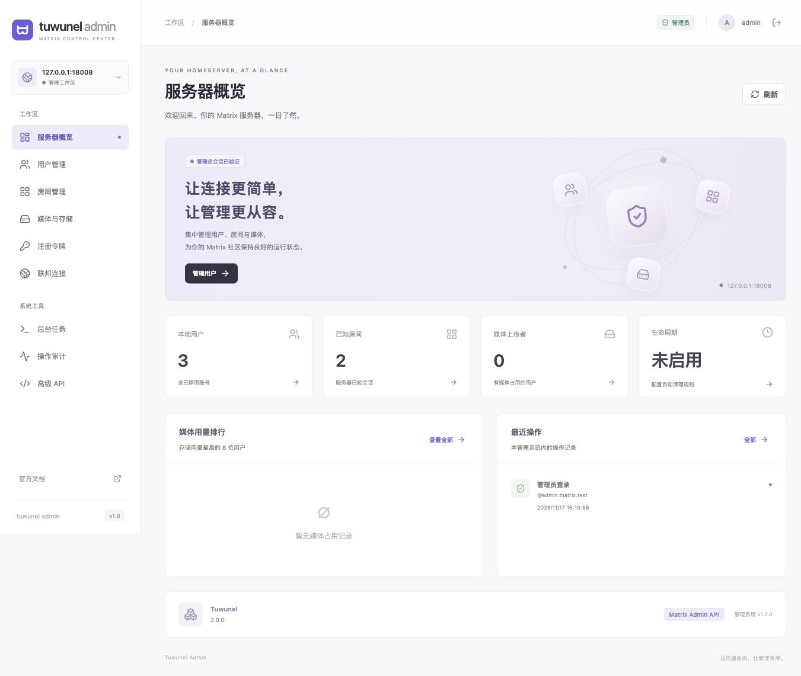

# Tuwunel Admin

中文 Tuwunel / Matrix 服务器管理中心。使用真实 Matrix 管理员账号或 Access Token 登录，通过 Tuwunel 已实现的管理 API 操作用户、房间、媒体与联邦连接。

**镜像：`utoptop/tuwunel-admin:1.0`** · 支持 `linux/amd64` / `linux/arm64` · MIT License



## 功能

| 模块 | 功能 |
| --- | --- |
| 用户 | 搜索与分页、创建、资料与管理员权限、重置密码、注销设备、锁定/解锁、暂停/恢复、停用、停用并擦除、重新启用 |
| 用户详情 | 加入房间、设备管理、上传媒体、连接信息、成员关系、账户数据 |
| 房间 | 搜索、成员/状态/事件/媒体查询、加入成员、授予房间管理员、封禁、清理历史、异步删除与结果查询 |
| 媒体 | 用户存储排行、MXC 元数据、单个删除、按用户分页删除、按时间/大小清理、远程缓存清理 |
| 生命周期 | 本地与远程保留天数、最小大小、头像保留、执行间隔、立即执行、最近结果、重启后恢复计划 |
| 注册与联邦 | 注册令牌创建/修改/删除、连接状态、共享房间、重试连接 |
| 高级 API | 73 个操作模板：69 个 Synapse 兼容操作，加 4 个 Matrix 原生锁定/暂停操作；支持路径参数、查询 JSON 与正文 JSON |
| 系统 | 后台管理任务、服务器通知、操作审计、响应式中文界面 |

### 兼容性与真实语义

实现依据：[Tuwunel 官方管理 API 文档](https://matrix-construct.github.io/tuwunel/development/compliance/synapse-admin.html) 与 [官方源码 `2a0ae4be1c7f036714cecb91edd9247cf06c09d0`](https://github.com/matrix-construct/tuwunel/tree/2a0ae4be1c7f036714cecb91edd9247cf06c09d0)。已在官方 `jevolk/tuwunel:main` 的 Tuwunel 2.0.0 上完成真实集成测试，镜像摘要见 [测试记录](docs/TESTING.md)。早期版本或不同认证模式可能缺少部分端点，界面会显示上游错误，不会把不支持的操作报告为成功。

- **用户删除**：调用 `deactivate` 并设置 `erase=true`。停用、注销设备并擦除资料，但不物理删除 Matrix ID，不删除所有远端副本，也不等于批量撤回消息。需要撤回时使用高级 API 中的用户事件撤回操作。
- **加密房间**：可以查询服务器存储的事件；端到端加密消息仍是密文，系统不持有解密密钥。
- **媒体时间**：Tuwunel 按存储文件修改时间计算，不是最后访问时间。媒体清理 API 没有 dry-run。头像保留开关仅适用于本地清理。
- **MAS / SSO**：使用已有客户端的管理员 Access Token 登录。密码重置、注册令牌、共享密钥注册、用户模拟登录等端点在 MAS 模式下不可用；不会尝试绕过外部认证系统。
- **上游限制**：媒体隔离/保护、举报管理等官方未实现功能不提供虚假按钮。`user_type`、`external_ids`、`approved` 等上游忽略的字段不作为已支持能力。用户创建时间为上游 `0` 占位值，不显示为真实日期。
- **不是 Tuwunel 配置文件编辑器**：数据库备份、TLS、联邦总开关和服务器进程配置仍由部署环境管理。所有界面数据来自真实上游，程序没有演示数据模式。

## Docker Compose 部署

```bash
git clone https://github.com/utoptop/tuwunel-admin.git
cd tuwunel-admin
cp .env.example .env
# 编辑 .env：填写 Matrix 地址、管理站点访问地址及 Cookie 设置
docker compose up -d
```

本机访问 `http://localhost:8080`。默认仅监听 `127.0.0.1`；通过反向代理提供远程 HTTPS 访问。

HTTPS 部署 `.env` 示例：

```dotenv
MATRIX_HOMESERVER_URL=https://matrix.example.com
PUBLIC_URL=https://admin.example.com
COOKIE_SECURE=true
PORT=8080
BIND_ADDRESS=127.0.0.1
```

`MATRIX_HOMESERVER_URL` 必须是上游实际监听地址，不一定与 Matrix ID 的域名相同。只接受 HTTP(S) origin，不包含路径或凭据。后端访问上游，无需给浏览器配置 Matrix CORS。

Caddy 示例（Caddy 运行在同一宿主机时）：

```caddyfile
admin.example.com {
    reverse_proxy 127.0.0.1:8080
}
```

若 Tuwunel 与管理系统位于同一个 Docker 网络，可使用 `http://tuwunel:8008` 作为上游，并将两个服务连接到该网络。容器中的 `localhost` 指向容器自身。Docker Desktop 访问宿主机可使用 `host.docker.internal`。

不使用 Compose：

```bash
docker run -d --name tuwunel-admin --restart unless-stopped \
  -p 127.0.0.1:8080:8080 \
  -e MATRIX_HOMESERVER_URL=https://matrix.example.com \
  -e PUBLIC_URL=http://localhost:8080 \
  -v tuwunel-admin-data:/app/data \
  utoptop/tuwunel-admin:1.0
```

## 媒体生命周期

1. 在「媒体与存储 → 生命周期」设置本地保留天数、远程缓存保留天数、清理间隔和头像保留选项。
2. 配置一个**独立的管理员 Access Token**。不要使用即将退出的浏览器会话令牌；计划与网页登录令牌分开管理。可以通过独立 Matrix 客户端会话获取，或在高级 API 中有意识地使用「生成用户访问令牌」并设置 `valid_until_ms`。后者在 MAS 模式下不可用。
3. 开启并确认保存后，首次执行在一个配置间隔之后。可手动「立即执行」已保存策略。
4. 管理容器每分钟检查到期任务。重启后恢复计划，逾期任务在下一次检查时执行。失败也会保存状态和下次执行时间；若本地成功、远程失败，会保留部分完成的计数。

计划运行前重新验证令牌的管理员权限。令牌过期、撤销或失去管理员权限后清理会失败；更新凭据即可恢复。更换上游地址后必须重新保存策略，系统不会拿旧凭据清理新服务器。停止容器会暂停计划。

这是管理系统的定时任务，**不修改 Tuwunel 原生配置**。仅支持一个管理进程/实例共享一个数据卷，不支持多个副本同时调度。

## 配置与数据

| 环境变量 | 默认值 | 说明 |
| --- | --- | --- |
| `MATRIX_HOMESERVER_URL` | 无 | 固定上游，必须配置；浏览器不能指定任意代理目标 |
| `PUBLIC_URL` | 当前请求的 origin | 建议明确配置，与浏览器地址完全一致，用于来源校验 |
| `COOKIE_SECURE` | `false` | HTTPS 部署设为 `true` |
| `PORT` | `8080` | 服务监听端口；Compose 容器内部固定 8080，变量控制宿主映射 |
| `HOST` | `0.0.0.0` | Node 监听地址 |
| `DATA_DIR` | `./data` / 镜像内 `/app/data` | 策略与审计持久化目录 |
| `ENCRYPTION_KEY` | 自动生成 | 可选，32 字节随机值的 base64，直接运行时传入；Compose 默认使用卷内自动密钥 |

数据卷包含 `state.json`（策略、最近 2,000 条审计）和 `encryption.key`。计划令牌采用 AES-256-GCM 加密；本地文件权限为 0600。**备份和恢复必须包含两个文件**。默认密钥与密文位于同一受保护卷中，拿到整个卷即可解密；需要分离密钥时用部署平台的 secret 管理传入 `ENCRYPTION_KEY`，并将其纳入独立备份。不要直接替换密钥后继续使用旧密文；先停用计划并重新保存凭据。

网页登录会话只保存在内存，12 小时过期，重启需重新登录。Cookie 为 HttpOnly / SameSite=Strict，写请求检查 Origin 和 CSRF。网页登录产生的 Matrix 设备令牌在正常退出时注销；导入令牌退出时仅清除本地会话。进程异常停止不会自动注销此前创建的 Matrix 设备，可在客户端/设备管理中清理。密码不持久化，令牌不放入浏览器 LocalStorage。

管理接口按服务端操作目录白名单转发，禁止任意 URL、路径穿越、重定向和查询参数携带凭据。请求体上限 128 KiB，上游响应上限 8 MiB，超时 30 秒；大数据查询应使用分页。长任务请使用异步 API。登录失败限速为每个直接连接 IP 十分钟内十次，反向代理后的客户端共享代理 IP 的额度。

审计仅记录本系统内的操作名称、目标、操作者、结果；不记录密码、令牌或完整请求体。它不是不可篡改的企业审计平台。

## 本地开发与验证

需要 Node.js 24+。

```bash
npm ci
cp .env.example .env
# .env 配置 MATRIX_HOMESERVER_URL 与 PUBLIC_URL=http://localhost:5173
npm run server
# 另一个终端
npm run dev
```

```bash
npm run check       # 本地 HTTP 集成测试 + TypeScript + Vite 生产构建
npm start           # 提供 dist 与 API，访问配置的 PORT
docker build -t tuwunel-admin:local .
```

真实 Tuwunel 测试流程见 [docs/TESTING.md](docs/TESTING.md)。API 清单见 [docs/API.md](docs/API.md)，测试代码不会自动连接生产服务器。

## 发布

仓库的 CI 会测试并构建容器。Docker 发布工作流需要仓库 Actions Secrets：`DOCKERHUB_USERNAME` 和 `DOCKERHUB_TOKEN`，可手动触发或推送 `v1.0` / `v1.0.*` 标签，发布 `utoptop/tuwunel-admin:1.0` 双架构镜像。GitHub PAT 不能替代 Docker Hub 凭据；不要提交任何凭据或 `.env`。

本地发布：

```bash
docker login
docker buildx build --platform linux/amd64,linux/arm64 \
  -t utoptop/tuwunel-admin:1.0 --push .
```

项目由 React / TypeScript / Vite 前端和 Node.js 原生 HTTP 后端组成。运行镜像不包含开发工具、源码测试、环境文件或前端依赖目录，以非 root 用户运行。升级前备份数据卷。

## 常见问题

- **来源不匹配**：`PUBLIC_URL` 的协议、主机名、端口必须与浏览器一致，修改后重建容器。
- **登录失败 / API 不支持**：确认管理员身份、最新 Tuwunel 管理 API 支持情况及 MAS 模式。后端不支持通过管理房间聊天命令降级模拟 API。
- **502 / TLS**：检查容器到上游的网络、证书链和代理。系统不关闭 TLS 验证，也不自动跟随重定向。
- **Cookie 未保存**：仅 HTTPS 地址使用 `COOKIE_SECURE=true`。本地 HTTP 测试设为 `false`。
- **数据卷权限**：镜像用户为 `node`（UID 1000）。使用命名卷最方便；绑定目录必须可供此用户写入。
- **媒体统计为 0**：表示上游没有符合条件的实际媒体记录，不是整个磁盘使用量。Tuwunel 不提供 PostgreSQL 房间存储估算 API。

这是独立管理工具，与 Tuwunel 官方项目无隶属关系。
