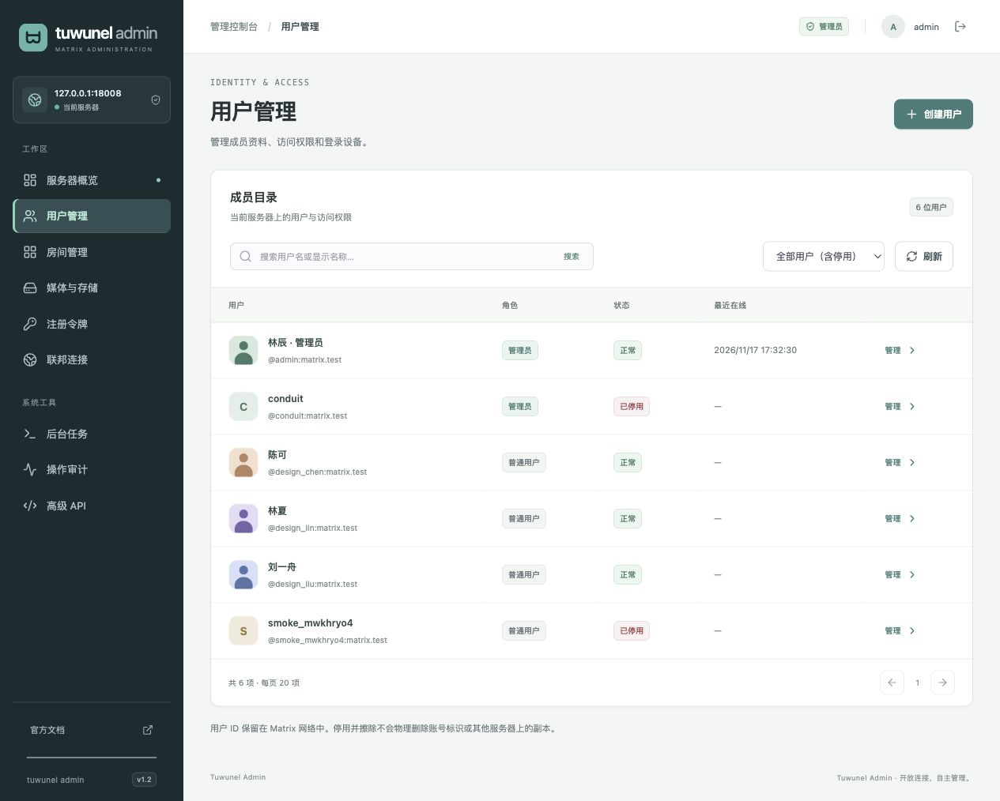
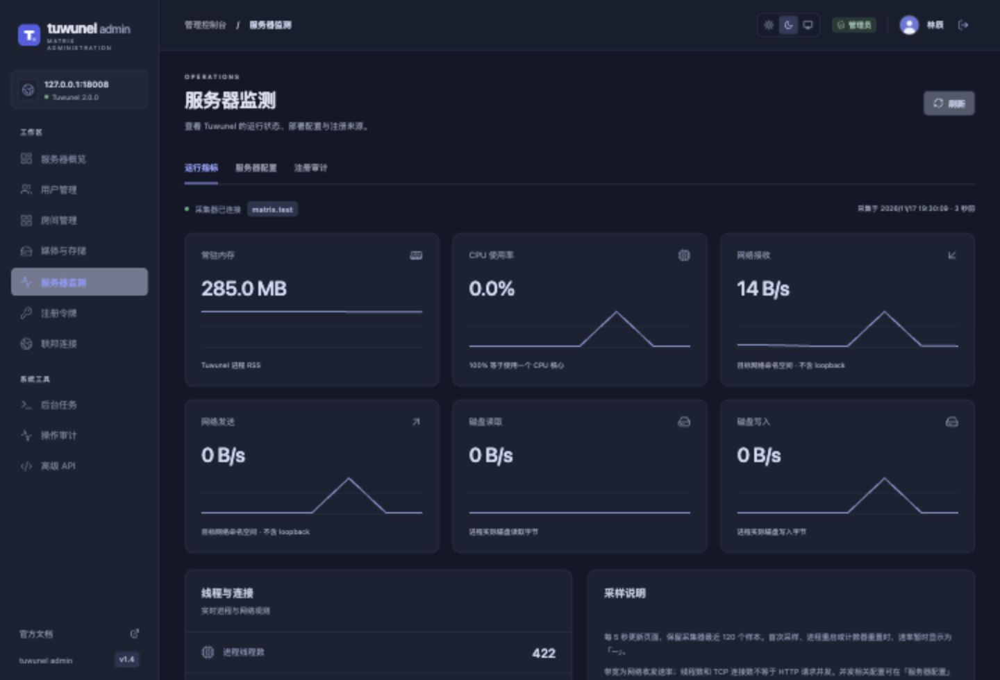

# 验证记录与复现

## 自动化测试

Rust 1.4.0 的 `npm test` 包含 **8 项 Rust 测试 + 35 项 HTTP 集成测试 + 1 项发布清理范围测试**。HTTP 测试启动实际编译后的 Rust 二进制，连接隔离的本地 Matrix 模拟服务，不是对旧 Node 服务器进行测试。

覆盖管理员与非管理员登录、Cookie、Origin/CSRF、白名单与路径编码、请求大小、写操作确认、上游不支持错误、计划凭据加密与重载、清理参数、部分失败、权限撤销、退出及登录限速。

配置与原有功能验证：

- TOML 未知字段、无效范围、HTTPS Cookie 配置；部署锁定在后端强制执行。
- 自定义地址与允许列表，私网/IP 映射、DNS 内网解析及重定向防护。
- 两个服务器返回相同 Matrix ID 时，审计、媒体策略、令牌仍然隔离。
- 原 Node AES-GCM 密文可解密，旧数据自动备份并迁移；同一数据目录不能被两个进程占用。
- Rust 进程重启后，自动任务无需浏览器会话即可继续运行。

认证与头像新增验证：

- 根据服务端能力识别密码、SSO、OAuth；固定地址规则同样作用于发现和认证发起接口。
- SSO 浏览器绑定、一次性 state、错误浏览器/回调重放拒绝、普通用户拒绝及上游退出。
- OAuth 动态注册、PKCE S256 交换、issuer 不匹配、取消、并发续期互斥、刷新令牌轮换、撤销及续期失败。
- 注册客户端 ID 重启复用，预注册公共客户端，以及独立内网 Auth 的显式允许规则。
- 头像必须使用当前会话：认证缩略图、旧端点回退、跨服务器请求拒绝、SVG/HTML/超大响应和重定向防护。

`npm run build` 执行 TypeScript 检查和 Vite 生产构建。Docker 镜像有独立的生产构建与健康检查。

## 真实 Tuwunel 冒烟测试

2026-11-17 在官方 `jevolk/tuwunel:main` 验证，服务器返回 `2.0.0`。当次镜像摘要：

```text
sha256:953890fd1273e005b1523c6f2fd7086a04133582aaa29c51d58e89e8338967e0
```

此脚本创建和删除测试账号、房间与媒体。仅用于下列专用临时容器，固定地址 `127.0.0.1:18008`、服务器名 `matrix.test`；**不要映射生产数据目录，不要针对生产服务器运行**。

```bash
docker run -d --rm --name tuwunel-admin-integration \
  -p 127.0.0.1:18008:8008 \
  -e TUWUNEL_SERVER_NAME=matrix.test \
  -e TUWUNEL_ALLOW_REGISTRATION=true \
  -e TUWUNEL_REGISTRATION_TOKEN=local-integration-only \
  -e TUWUNEL_ALLOW_FEDERATION=false \
  -e TUWUNEL_ADDRESS=0.0.0.0 \
  jevolk/tuwunel:main

# 待 /_matrix/client/versions 返回成功后执行
cargo build
node tests/real-smoke.mjs
docker stop tuwunel-admin-integration
```

真实验证覆盖：

- 自动检测密码登录、管理员登录与退出，服务器版本查询。
- 真实 PNG 头像上传、修改用户头像、用户列表返回头像地址、通过当前会话读取缩略图。
- 用户创建、搜索、详情、密码重置后真实登录、锁定/解锁、暂停/恢复及原生 Matrix 管理端点。
- 设备创建、列表、改名、删除。
- 房间创建、管理员加入成员、用户加入房间列表、成员、状态与事件查询。
- 文件真实上传、媒体元数据、用户媒体列表、统计与单项删除。
- 注册令牌创建、修改、列表与删除。
- 持久化生命周期策略，真实调用本地清理与远程缓存清理。
- 联邦目标列表、服务器通知。
- 房间封禁、异步删除及轮询任务直到完成。
- 用户停用并擦除后的状态验证、操作审计。

Rust 版本在同一官方镜像上重新完成上述真实联调。脚本中的 Tuwunel 环境变量仅用于配置独立的上游测试容器，管理系统本身只使用临时 TOML 文件。

浏览器验证：固定模式仅显示服务器信息；开放模式可输入地址，清空地址会移除旧登录方式；密码模式仅提供账号密码，SSO 模式不出现密码框。使用本地模拟身份提供商完成浏览器跳转和认证回跳。真实 Tuwunel 用户列表与详情中的头像成功读取，桌面及 390px 手机布局没有页面横向溢出，表格在自己的容器内横向滚动，控制台没有警告或错误。

截图中的账号和头像来自专用测试服务器，不是生产用户。认证页截图使用本地模拟 SSO 服务。



## 真实 Tuwunel OAuth 联调

另启动一个完全独立的 `matrix.test` 临时实例，启用 Tuwunel 原生 OAuth：

```bash
docker run -d --rm --name tuwunel-admin-oidc-integration \
  -p 127.0.0.1:18009:8008 \
  -e TUWUNEL_SERVER_NAME=matrix.test \
  -e TUWUNEL_ALLOW_REGISTRATION=true \
  -e TUWUNEL_REGISTRATION_TOKEN=local-integration-only \
  -e TUWUNEL_ALLOW_FEDERATION=false \
  -e TUWUNEL_ADDRESS=0.0.0.0 \
  -e TUWUNEL_WELL_KNOWN__CLIENT=http://127.0.0.1:18009 \
  -e TUWUNEL_AUTHENTICATION__OIDC__NATIVE_AUTH=true \
  jevolk/tuwunel:main

cargo build
node tests/real-oidc-smoke.mjs
docker stop tuwunel-admin-oidc-integration
```

该协议级测试通过真实 Tuwunel 完成：元数据发现、公共客户端动态注册、原生账号认证、同意授权、HTML 回跳、PKCE 授权码兑换、管理员身份确认、用 OAuth Token 调用管理 API，以及退出后核实上游设备会话被撤销。

测试使用 `https://admin.example.com` 作为注册的回调 origin，HTTP 测试驱动截获回调并转交给本地 Rust 服务，不访问这个域名。这个测试验证协议，不验证部署域名的 TLS。正式部署仍需真实 HTTPS 域名与正确的反向代理、Cookie 和回调配置。短时间内反复运行可能触发 Tuwunel 的认证限速，应等待返回的重试时间。

## 1.3 身份、桥接与令牌验证

新增集成测试覆盖：管理员资料与上游版本独立失败；用户房间名称、头像与不可读取房间的 ID 保留；跨上游分页的 Signal UUID / Telegram 数字规则分类；管理员及普通账号保护；预览不写数据、绑定会话、错误确认和重复执行拒绝；预览后权限变化；媒体始终从第 0 页循环删除；部分失败与重试；配置令牌只读标记且不误判无限制数据库令牌；发布脚本保留当前、被容器引用和其他项目的镜像。

启动上文 18008 临时 Tuwunel 后运行：

```bash
cargo build
node tests/real-workspace-smoke.mjs
```

2026-11-17 在同一官方 Tuwunel 2.0.0 镜像上实测：管理员头像与版本、加入房间名称与头像；创建 Signal/Telegram 测试账号，写入媒体、设备、账户数据并加入房间；批量清理后共删除 4 个用户所属媒体，复核资料擦除、设备/房间/账户数据/媒体清空，原密码无法登录；真实配置令牌返回只读错误，数据库令牌可正常创建、修改、删除。

浏览器验证：右上角管理员头像、房间头像均从真实媒体接口加载为 96px PNG；普通用户与桥接用户分组、Telegram 筛选、全量预览及确认文字门槛正确；390px 手机布局无页面横向溢出，控制台无警告或错误。浏览器只验证清理预览和确认门槛，实际不可逆操作由上述专用临时 API 联调测试执行。截图中所有账号与房间均为临时测试数据。

## 1.4 全量媒体、监测与无限加载验证

2026-11-17，`npm run check` 共 44 项检查通过。新增覆盖：两位用户 251 + 113 个媒体文件跨全部批次清空；准确确认文字、仅限本地用户、任务冲突、取消、空删除结果、匿名访问拒绝；重启保留计数并中断任务；房间头像补充与缺失元数据容错；监测快照匹配 homeserver 和 Matrix server_name、过期提示、配置秘密字段过滤；Linux RSS/线程/TCP/CPU/带宽采样与进程重启判断；401 认证挑战不计为失败，只有成功注册响应关联用户 ID。

在专用 Tuwunel 2.0.0 实例完成 `node tests/real-workspace-smoke.mjs` 后，运行 `node tests/real-media-smoke.mjs`：两位用户分别上传 **215 和 137 个真实文件，共 352 个**，全量任务完成后媒体列表总数为 0，两位账号保持未停用；服务器房间目录返回真实名称与 MXC 头像。

OpenResty 官方镜像 `openresty/openresty:alpine`（1.31.8.1）实际启用本文档提供的 Lua 注册日志配置，代理专用测试服务器完成 UIA 401 → 注册 200；日志正确包含成功用户 ID 与来源 IP，挑战记录没有用户 ID，密码、注册令牌、access_token 均未进入日志。

浏览器在 1440px 桌面及 390px 手机布局验证：用户由 20 自动追加到 40、52 条，房间由 20 追加到 28 条；搜索重置为单一匹配项，没有重复行。房间头像实际加载，管理员头像在手机和桌面均显示；深浅主题切换及刷新后保存正常。全量媒体操作在确认文字未匹配时禁止执行，输入正确文字才启用；浏览器未执行不可逆删除。手机表格内部滚动，页面没有横向溢出，控制台无警告或错误。

发布镜像 `utoptop/tuwunel-admin:1.4` 的容器验收：非 root 管理进程健康检查、管理员登录、20 条房间及头像、媒体任务接口、退出均通过。独立 `tuwunel-observer` 容器在只读根文件系统、只读配置/日志挂载下共享测试 Tuwunel 的 PID 和网络命名空间；采集 RSS、CPU、网络速率、线程及 TCP 连接成功。官方 root Tuwunel 的磁盘 I/O 在默认 cap_drop ALL 下不可读，使用文档中仅目标 PID 命名空间的 SYS_PTRACE 覆盖后成功读取。采样包含真实 I/O 速率，无诊断错误；配置令牌未进入快照。浏览器核实成功账号创建 IP、4 次注册拒绝与 1 次正常认证挑战分别呈现，用户详情可定位创建来源。监测页在 390px 无横向溢出。




## 1.1 版本的历史性能对比

2026-11-17，Apple M4 / macOS arm64，Node 25.9.0 对比 1.1.0 管理后端的 Rust 1.93.1 `--release`。基线为原 Node 版提交 `7f243d147761cb59c89b161d1201623ad852b2d3`。两个后端分别在独立进程运行，同一台机器上的 Node HTTP 模拟上游返回相同的空用户列表。客户端复用连接，32 并发，每轮每项 5,000 请求，3 轮交替顺序，取吞吐中位数。

| 项目 | 原 Node 后端 | Rust 后端 |
| --- | ---: | ---: |
| `/api/health` | 29,687 请求/秒 | 42,469 请求/秒 |
| 已登录的用户列表代理 `/api/admin` | 9,459 请求/秒 | 21,064 请求/秒 |
| 登录后、压测前 RSS | 64.6 MiB | 8.3 MiB |
| 最后一轮之后采样 RSS | 261.2 MiB | 11.1 MiB |

该次管理代理吞吐约为旧版的 **2.2 倍**。这些数值用于比较本地代理开销，不是生产性能保证：没有 TLS、远程网络、真实数据库或写入审计负载；客户端和模拟上游与后端竞争同一台机器的 CPU。Node 可能在后续 GC 后释放内存，RSS 采样不是峰值测量。真实用户操作耗时还取决于 Tuwunel 和网络。这里比较的是本机二进制，不是跨架构 Docker 性能。

复现（从仓库根目录执行，创建临时基线目录）：

```bash
cargo build --release --locked
baseline_dir=$(mktemp -d)
git archive 7f243d147761cb59c89b161d1201623ad852b2d3 server | tar -x -C "$baseline_dir"
node scripts/benchmark.mjs "$baseline_dir"
```

脚本自动关闭测试服务并清理自己创建的临时数据目录；保留上面的基线目录供复核。原始测量见 [benchmark-rust.json](benchmark-rust.json)。

上述历史性能数据不代表 1.2 的认证、头像或生产负载性能。未进行生产负载测试、外部商业 SSO/MAS 实例端到端测试、跨服务器联邦故障恢复、远程媒体实际重新下载或所有高级 API 的逐个破坏性测试。高级操作基于官方路由/类型定义映射，最终行为由目标服务器决定。
