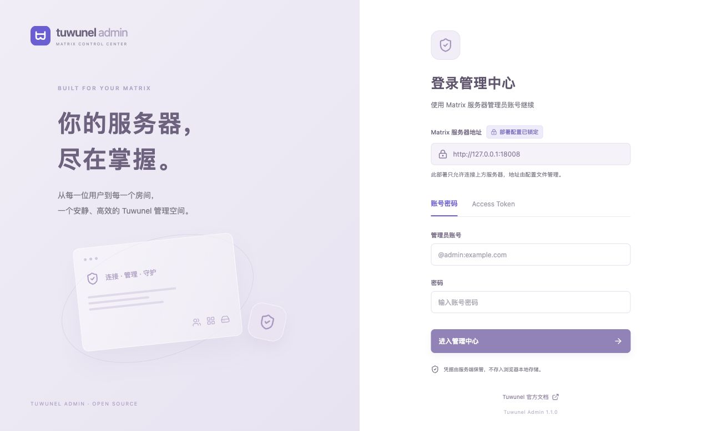

# 验证记录与复现

## 自动化测试

Rust 1.1.0 的 `npm test` 包含 **5 项 Rust 测试 + 13 项 HTTP 集成测试**。HTTP 测试启动实际编译后的 Rust 二进制，连接隔离的本地 Matrix 模拟服务，不是对旧 Node 服务器进行测试。

覆盖管理员与非管理员登录、Cookie、Origin/CSRF、白名单与路径编码、请求大小、写操作确认、上游不支持错误、计划凭据加密与重载、清理参数、部分失败、权限撤销、退出及登录限速。

本次新增验证：

- TOML 未知字段、无效范围、HTTPS Cookie 配置；部署锁定在后端强制执行。
- 自定义地址与允许列表，私网/IP 映射、DNS 内网解析及重定向防护。
- 两个服务器返回相同 Matrix ID 时，审计、媒体策略、令牌仍然隔离。
- 原 Node AES-GCM 密文可解密，旧数据自动备份并迁移；同一数据目录不能被两个进程占用。
- Rust 进程重启后，自动任务无需浏览器会话即可继续运行。

`npm run build` 执行 TypeScript 检查和 Vite 生产构建。Docker 镜像有独立的生产构建与健康检查。

## 真实 Tuwunel 冒烟测试

2026-11-17 在官方 `jevolk/tuwunel:main` 验证，服务器返回 `2.0.0`。当次镜像摘要：

```text
sha256:953890fd1273e005b1523c6f2fd7086a04133582aaa29c51d58e89e8338967e0
```

此脚本创建和删除测试账号、房间与媒体。仅用于下列专用临时容器，固定地址 `127.0.0.1:18008`、服务器名 `matrix.test`；**不要映射生产数据目录，不要针对生产服务器运行**。

```bash
docker run -d --rm --name tuwunel-admin-integration \
  -p 127.0.0.1:18008:8008 \
  -e TUWUNEL_SERVER_NAME=matrix.test \
  -e TUWUNEL_ALLOW_REGISTRATION=true \
  -e TUWUNEL_REGISTRATION_TOKEN=local-integration-only \
  -e TUWUNEL_ALLOW_FEDERATION=false \
  -e TUWUNEL_ADDRESS=0.0.0.0 \
  jevolk/tuwunel:main

# 待 /_matrix/client/versions 返回成功后执行
cargo build
node tests/real-smoke.mjs
docker stop tuwunel-admin-integration
```

真实验证覆盖：

- 管理员密码登录与退出，服务器版本查询。
- 用户创建、搜索、详情、密码重置后真实登录、锁定/解锁、暂停/恢复及原生 Matrix 管理端点。
- 设备创建、列表、改名、删除。
- 房间创建、管理员加入成员、用户加入房间列表、成员、状态与事件查询。
- 文件真实上传、媒体元数据、用户媒体列表、统计与单项删除。
- 注册令牌创建、修改、列表与删除。
- 持久化生命周期策略，真实调用本地清理与远程缓存清理。
- 联邦目标列表、服务器通知。
- 房间封禁、异步删除及轮询任务直到完成。
- 用户停用并擦除后的状态验证、操作审计。

Rust 版本在同一官方镜像上重新完成上述真实联调。脚本中的 Tuwunel 环境变量仅用于配置独立的上游测试容器，管理系统本身只使用临时 TOML 文件。

浏览器验证：原版已验证用户列表、房间详情、生命周期表单和高级 API；Rust 版重新验证自定义地址输入、浏览器锁定/取消锁定、刷新后记住地址、真实管理员登录/退出、部署锁定只读输入。桌面和 390px 手机宽度均无横向溢出，浏览器没有控制台警告或错误。截图展示的是独立测试服务器。



## 本地性能对比

2026-11-17，Apple M4 / macOS arm64，Node 25.9.0 对比 Rust 1.93.1 `--release`。基线为原 Node 版提交 `7f243d147761cb59c89b161d1201623ad852b2d3`。两个后端分别在独立进程运行，同一台机器上的 Node HTTP 模拟上游返回相同的空用户列表。客户端复用连接，32 并发，每轮每项 5,000 请求，3 轮交替顺序，取吞吐中位数。

| 项目 | 原 Node 后端 | Rust 后端 |
| --- | ---: | ---: |
| `/api/health` | 29,687 请求/秒 | 42,469 请求/秒 |
| 已登录的用户列表代理 `/api/admin` | 9,459 请求/秒 | 21,064 请求/秒 |
| 登录后、压测前 RSS | 64.6 MiB | 8.3 MiB |
| 最后一轮之后采样 RSS | 261.2 MiB | 11.1 MiB |

该次管理代理吞吐约为旧版的 **2.2 倍**。这些数值用于比较本地代理开销，不是生产性能保证：没有 TLS、远程网络、真实数据库或写入审计负载；客户端和模拟上游与后端竞争同一台机器的 CPU。Node 可能在后续 GC 后释放内存，RSS 采样不是峰值测量。真实用户操作耗时还取决于 Tuwunel 和网络。这里比较的是本机二进制，不是跨架构 Docker 性能。

复现（从仓库根目录执行，创建临时基线目录）：

```bash
cargo build --release --locked
baseline_dir=$(mktemp -d)
git archive 7f243d147761cb59c89b161d1201623ad852b2d3 server | tar -x -C "$baseline_dir"
node scripts/benchmark.mjs "$baseline_dir"
```

脚本自动关闭测试服务并清理自己创建的临时数据目录；保留上面的基线目录供复核。原始测量见 [benchmark-rust.json](benchmark-rust.json)。

未进行生产负载测试、外部 SSO/MAS 实机测试、跨服务器联邦故障恢复、远程媒体实际重新下载或所有高级 API 的逐个破坏性测试。高级操作基于官方路由/类型定义映射，最终行为由目标服务器决定。
